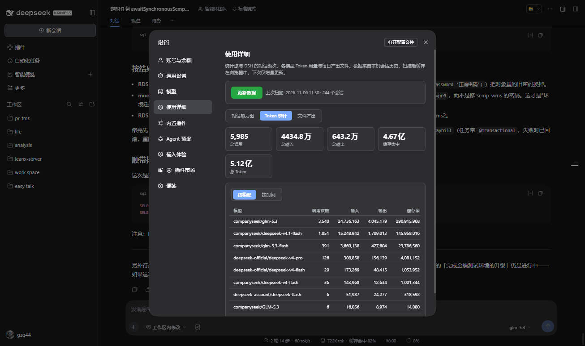

# dsh-usage-detail

[English](#english) | [中文](#中文)

<a id="中文"></a>

DSH（DeepSeek Harness）插件：**使用详细** —— 设置面板里的使用统计中心。



## 功能

安装后，Web GUI 的「设置」中会出现「**使用详细**」导航项（位于「模型」与「内置插件」之间），包含三个标签页：

| 标签页 | 内容 |
|---|---|
| **对话热力图** | GitHub 风格的一年绿色热力图，颜色深浅 = 每天您本人发送的消息数（自动排除子代理会话与系统注入上下文）。打开自动定位到当前月份；顶部统计卡显示累计消息、活跃天数、最长连续、单日峰值 |
| **Token 统计** | 全部历史会话的 token 用量。**按模型**：每个 provider/model 的调用次数、输入/输出/缓存读/缓存写/推理/总量；**按时间**：天 / 周 / 月粒度的时间段汇总（周一起始）。顶部统计卡用万/亿（或 K/M）紧凑显示总量 |
| **文件产出** | 每天通过 `write` / `edit` 工具产出或修改的文件清单，可任选日期查看：日期选择器、前后翻天、最近有产出日期快捷跳转，按路径去重并分别标注新建/修改次数 |

卡片风格 UI，自动适配 DSH 明暗主题；文案中英双语。

## 安装

已发布到 npm，在任意会话里对 agent 说「安装 dsh-usage-detail」，或直接执行：

```bash
dsh plugin --profile web add dsh-usage-detail
```

也可以从 GitHub 安装：

```bash
dsh plugin --profile web add github:gzq44/dsh-usage-detail
```

## 实现原理

- **数据源**：官方 session Remote API。浏览器端调用 `session/list` 枚举全部会话，再对每个会话用 `session/events`（`beforeSeq` 排他上限）向后翻页读取完整事件流；子代理会话通过专用 subagent 地址读取。宿主半边零代码、零权限，不上传任何数据。
- **聚合**：
  - 热力图：`user/message` 且 `source.kind === "user"` → 按本地日期分桶；
  - Token：`assistant/message` 的 `data.usage`（inputTokens / outputTokens / cacheReadTokens / cacheWriteTokens / reasoningTokens）+ `data.message.source.{provider, model}` → 按模型累计、按天分桶；
  - 文件：`tool/call` 中 `write` / `edit` 的 `arguments.file_path` → 按天分组、按路径去重。
- **缓存与增量**：聚合结果连同每个会话的 `maxSeq` 检查点存入 `localStorage`；再次扫描只读取新增事件。翻页遇到 fork 继承标记（`session/end-seed {inherited}`）即停，父会话已统计的前缀不会重复计数。
- **权限**：只读您本机的会话历史，无网络上报、无文件写入。

## 隐私

所有统计均在浏览器本地完成并存储于 `localStorage`，不发送任何数据到第三方服务器。

## 开发

```bash
git clone https://github.com/gzq44/dsh-usage-detail.git
cd dsh-usage-detail
npm test          # 冒烟测试：加载 client.js、注册 settings.section、模拟扫描校验聚合
```

本插件无构建步骤：`lib/client.js` 是手写的浏览器 bundle（`window.__ModuleLoader__.load` 格式），修改后通过 `link:` 安装即可热更新。

## License

[MIT](LICENSE)

---

<a id="english"></a>

# dsh-usage-detail (Usage Detail)

A [DeepSeek Harness](https://github.com/deepseek-ai/deepseek-harness) plugin that adds a **Usage Detail** section to Settings with three tabs:

| Tab | What you get |
|---|---|
| **Heatmap** | GitHub-style one-year green heatmap of your own sent messages per day (subagent sessions and injected context excluded). Auto-scrolls to the current month on open; stat cards show totals, active days, longest streak, and daily peak |
| **Tokens** | Lifetime token usage across all sessions. **By model**: calls, input/output/cache-read/cache-write/reasoning/total per provider/model. **By time**: day / week / month buckets (Monday-start weeks). Stat cards show compact totals (K/M or 万/亿) |
| **Files** | Files created or edited per day via the `write`/`edit` tools — date picker, prev/next day, recent-days chips, per-path new/edited counts |

Card-style UI that follows the DSH light/dark theme; localized in English and Chinese.

## Install

Published on npm — tell your agent "install dsh-usage-detail", or run:

```bash
dsh plugin --profile web add dsh-usage-detail
```

Or install straight from GitHub:

```bash
dsh plugin --profile web add github:gzq44/dsh-usage-detail
```

## How it works

- **Data source**: the official session Remote API. The browser half lists every session with `session/list`, then pages each durable log backwards through `session/events`; subagent sessions use their typed subagent address. The host half is empty — no host-side code, no extra permissions, nothing leaves your machine.
- **Aggregation**: heatmap counts `user/message` events with `source.kind === "user"` by local day; tokens accumulate `assistant/message` usage per `provider/model` and bucket it by day; files group `write`/`edit` tool calls by `arguments.file_path` per day.
- **Caching**: aggregates plus a per-session `maxSeq` checkpoint live in `localStorage`; rescans are incremental. Fork-inherited prefixes (the `session/end-seed {inherited}` marker) stop the backward page so a parent's events are never double-counted.

## Privacy

All statistics are computed and stored locally in your browser. No data is sent to any third-party server.

## Development

```bash
git clone https://github.com/gzq44/dsh-usage-detail.git
cd dsh-usage-detail
npm test          # smoke test: loads client.js, registers the settings section, drives a fake scan
```

No build step: `lib/client.js` is a hand-written browser bundle (`window.__ModuleLoader__.load` format). Install via a `link:` dependency for live reload while developing.

## License

[MIT](LICENSE)
